# Gestionnaire de sondages (pollsFactory) : guide d'utilisation

Ce guide explique comment créer des sondages avec l'extension pollsFactory, les publier sur votre blog Dotclear et consulter les résultats.

## Sommaire

1. [Configurer l'extension](#configurer-lextension)
2. [Créer un sondage](#créer-un-sondage)
3. [Ajouter des questions](#ajouter-des-questions)
4. [Afficher un sondage sur le site](#afficher-un-sondage-sur-le-site)
5. [Consulter les résultats](#consulter-les-résultats)
6. [Gérer la liste des sondages](#gérer-la-liste-des-sondages)
7. [Préférences utilisateur](#préférences-utilisateur)

## Configurer l'extension

Ouvrez le menu **Plugins › Gestionnaire de sondages**, puis le lien de configuration depuis la page des extensions.

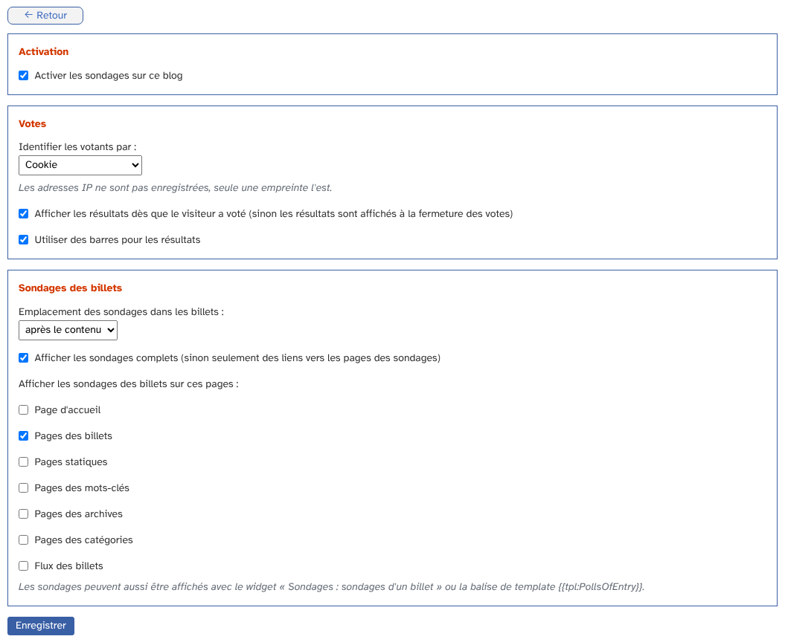

La page est divisée en trois blocs.

* **Activation** : cochez « Activer les sondages sur ce blog ». Tant que ce n'est pas fait, la liste des sondages reste inutilisable.
* **Votes** :
  * « Identifier les votants par » : *Cookie*, *Cookie et IP* ou *Adresse IP seulement*. Les adresses IP ne sont pas enregistrées, seule une empreinte l'est.
  * « Afficher les résultats dès que le visiteur a voté » : sinon, les résultats ne sont visibles qu'à la fermeture des votes.
  * « Utiliser des barres pour les résultats ».
* **Sondages des billets** : l'emplacement des sondages dans les billets (*masquer*, *avant le contenu*, *après le contenu*), l'affichage du sondage complet ou d'un simple lien, et les types de pages concernés (accueil, billets, pages statiques, mots-clés, archives, catégories, flux).

Cliquez sur **Enregistrer**.

## Créer un sondage

Dans la liste des sondages, cliquez sur **Nouveau sondage**. Renseignez le titre (obligatoire) et la description, puis enregistrez.

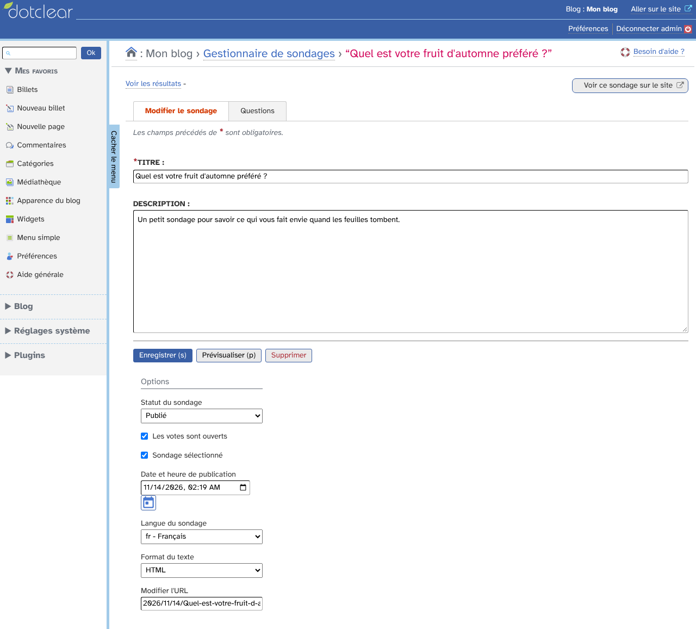

La colonne **Options** propose :

* le statut du sondage (publié ou non) ;
* « Les votes sont ouverts » : décochez pour fermer les votes ;
* « Sondage sélectionné » : met le sondage en favori, pour les widgets ;
* la date et l'heure de publication, la langue, le format du texte et l'URL.

Le bouton **Voir ce sondage sur le site** ouvre la page publique du sondage. **Voir les résultats** ouvre la page des résultats.

## Ajouter des questions

Un sondage s'utilise avec une ou plusieurs questions. Ouvrez l'onglet **Questions**.

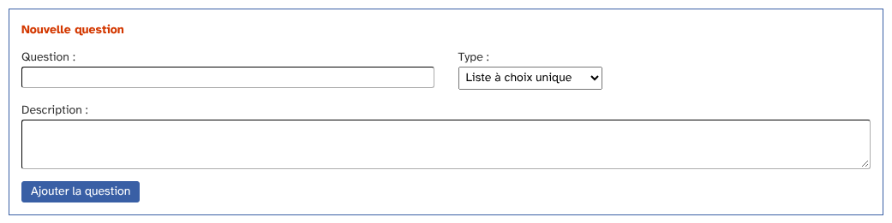

Saisissez l'intitulé, choisissez le type et ajoutez au besoin une description, puis cliquez sur **Ajouter la question**. Les types disponibles sont :

* *Liste à choix unique* ;
* *Liste à choix multiples* ;
* *Liste déroulante* ;
* *Champ texte* ;
* *Zone de texte*.

Pour les trois premiers types, ajoutez ensuite les choix.

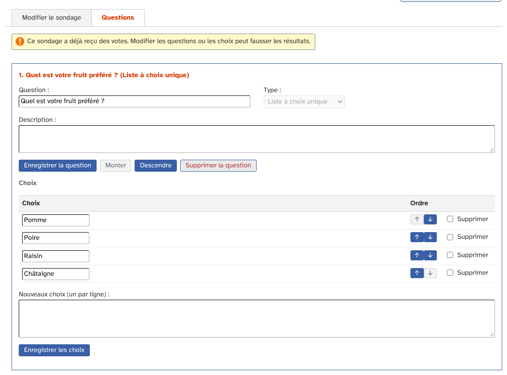

* Saisissez les nouveaux choix, un par ligne, puis cliquez sur **Enregistrer les choix**.
* Les flèches changent l'ordre des choix, la case « Supprimer » retire un choix.
* Les boutons **Monter** et **Descendre** changent l'ordre des questions, **Supprimer la question** la retire.

Une question de type liste sans aucun choix n'est pas affichée sur le site.

> Dès qu'un sondage a reçu des votes, un avertissement rappelle que modifier les questions ou les choix peut fausser les résultats.

## Afficher un sondage sur le site

Chaque sondage possède sa propre page publique. Il peut aussi être affiché de plusieurs façons.

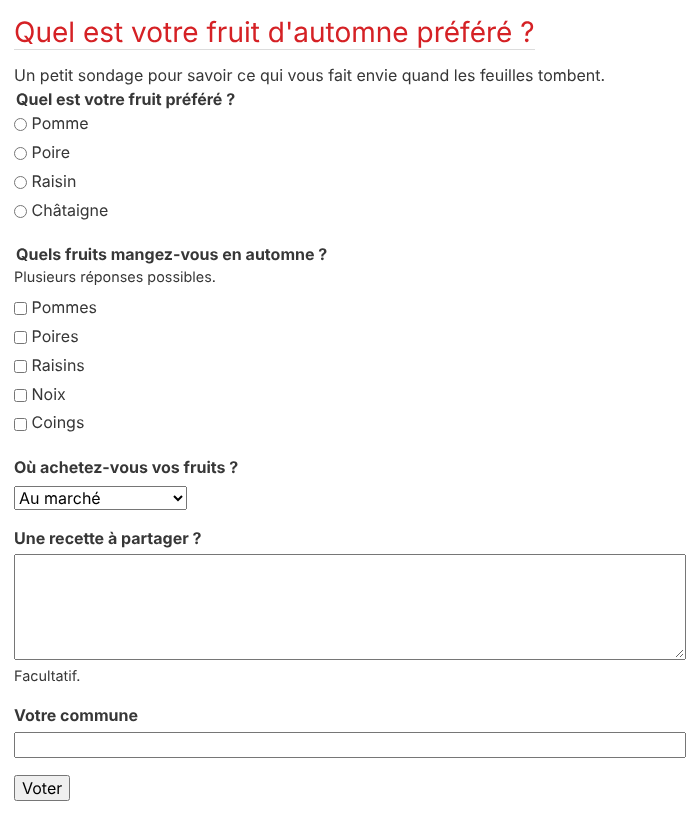

### Dans un billet ou une page

Dans la colonne latérale de l'édition d'un billet ou d'une page, le bloc « Gestionnaire de sondages » liste les sondages liés. Choisissez un sondage dans « Ajouter un sondage » pour le lier.

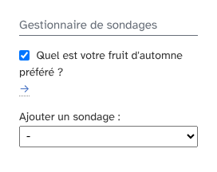

Les sondages liés sont affichés selon les réglages de la configuration (emplacement, pages concernées, sondage complet ou lien).

### Avec les widgets

Trois widgets sont disponibles dans **Apparence du blog › Widgets**.

* **Sondages : sondages sélectionnés** : les sondages marqués comme sélectionnés, avec leur formulaire.

  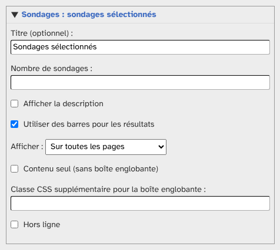

* **Sondages : liste** : une liste de sondages, avec le nombre, le tri, l'ordre et l'état des votes.

  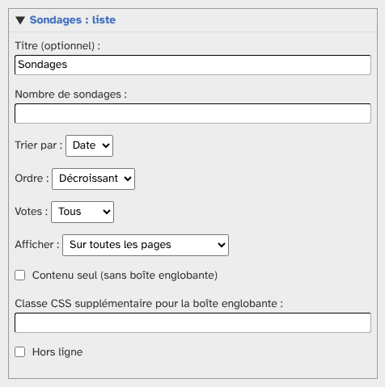

* **Sondages : sondages d'un billet** : les sondages liés au billet affiché.

  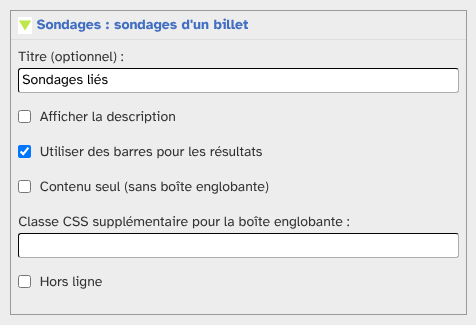

Voici le rendu sur le site.

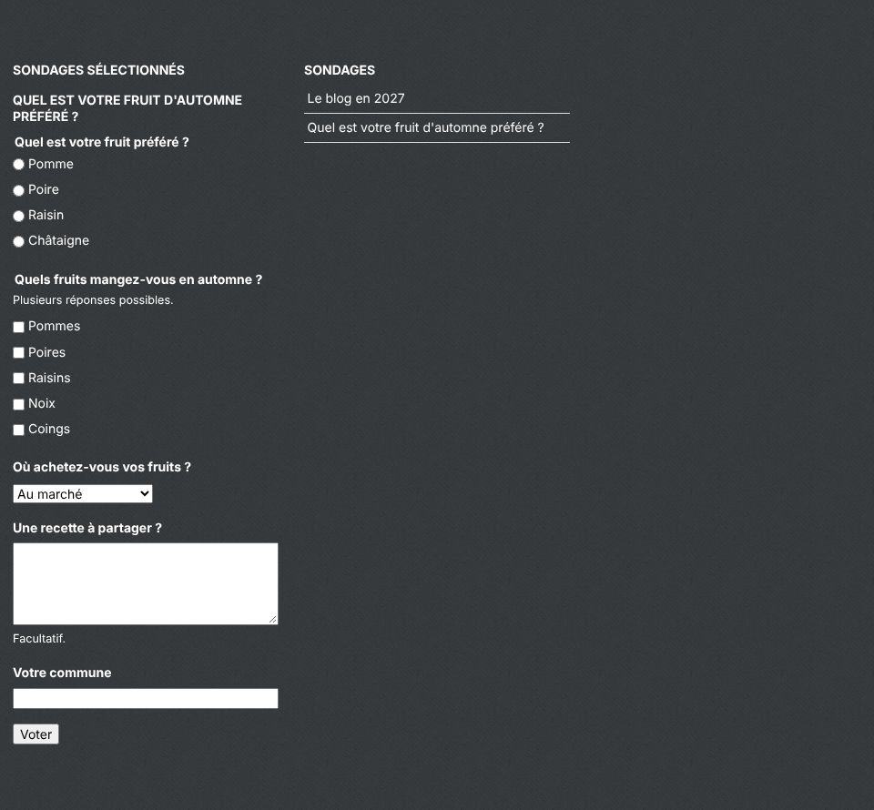

### Dans un template

Deux balises de template sont disponibles : `{{tpl:PollForm}}` pour le sondage courant et `{{tpl:PollsOfEntry}}` pour les sondages du billet courant.

### Résultats côté visiteur

Après son vote, le visiteur voit les résultats si l'option correspondante est cochée dans la configuration.

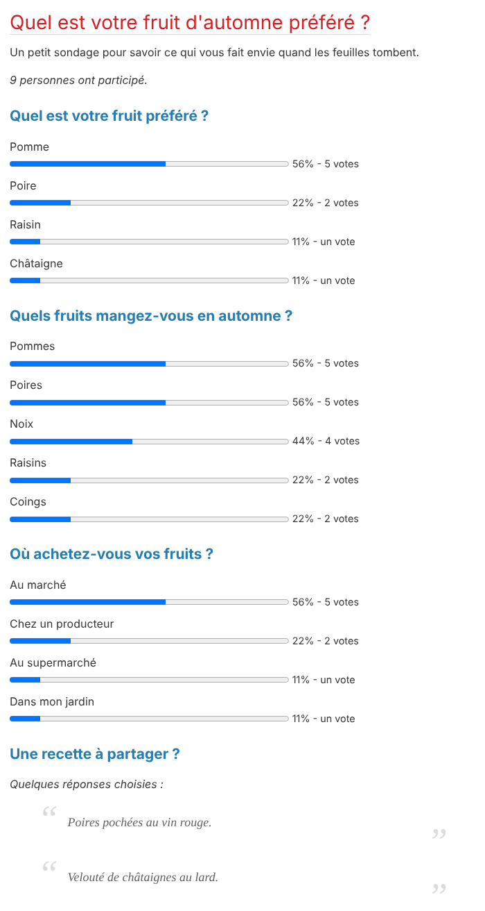

Si les votes sont fermés, le message « Ce sondage est fermé. » s'affiche.

## Consulter les résultats

Dans la liste, cliquez sur le nombre de votants d'un sondage, ou sur **Voir les résultats** dans la page du sondage.

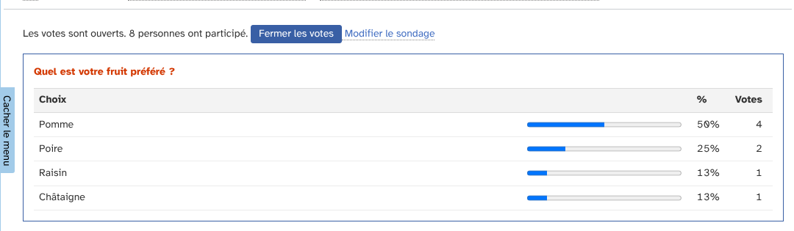

La page indique si les votes sont ouverts et combien de personnes ont participé. Le bouton **Fermer les votes** (ou **Ouvrir les votes**) change l'état du sondage. Chaque question affiche le pourcentage et le nombre de votes par choix.

### Réponses textuelles

Les questions de type texte listent toutes les réponses reçues.

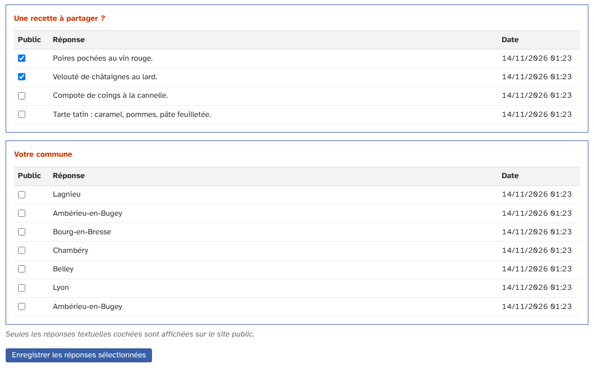

Seules les réponses cochées dans la colonne « Public » sont affichées sur le site, dans « Quelques réponses choisies ». Cliquez sur **Enregistrer les réponses sélectionnées** pour valider.

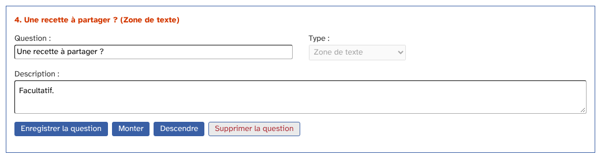

### Votants

La liste des votants permet de supprimer les réponses de certains visiteurs, par exemple en cas de vote en double.

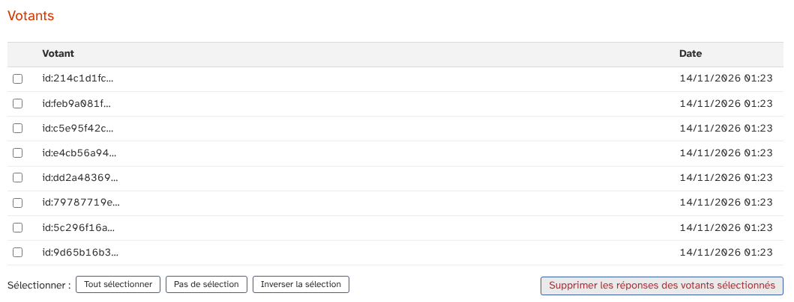

Cochez les votants, puis cliquez sur **Supprimer les réponses des votants sélectionnés**.

## Gérer la liste des sondages

La liste affiche pour chaque sondage son titre, l'état des votes, le nombre de votants et de billets liés, la date, l'auteur et le statut.

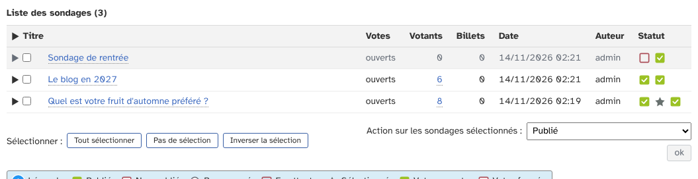

Les icônes de la colonne « Statut » indiquent si le sondage est publié, sélectionné, et si les votes sont ouverts.

### Filtres

Le bloc de filtres permet de chercher par texte, auteur, état, votes et sélection, et de régler le tri et le nombre de sondages par page.

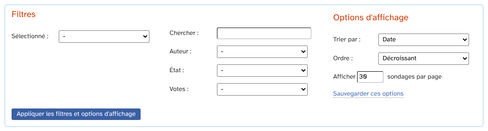

### Actions groupées

Cochez des sondages, choisissez une action puis cliquez sur **ok**.

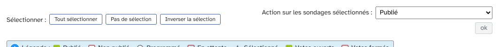

Les actions disponibles : changer le statut (publié, non publié), ouvrir ou fermer les votes, marquer comme sélectionné ou non, et supprimer.

### Favori

Dans **Préférences › Mes favoris**, ajoutez le gestionnaire de sondages à vos favoris pour y accéder depuis le menu.

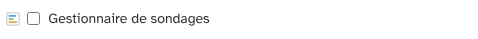

L'icône du tableau de bord affiche le nombre de sondages.

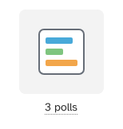

## Préférences utilisateur

Dans **Préférences › Mes options**, le bloc « Gestionnaire de sondages » choisit les colonnes affichées dans la liste : votes, votants, billets, date, auteur.

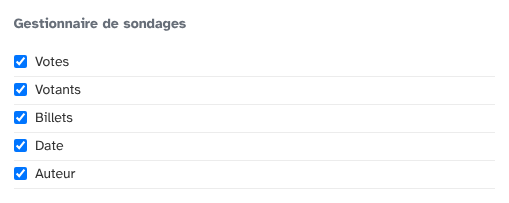
